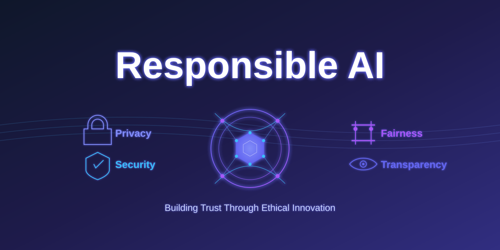

<div align="center">

# Who is Responsible? The Data, Models, Users or Regulations?
### A Comprehensive Survey on Responsible Generative AI for a Sustainable Future

[](#citation)
[](https://arxiv.org/abs/2502.08650)
[](https://anas-zafar.github.io/responsible-ai.github.io/)
[](#contents)

<!--  -->
</div>

## Overview

Welcome to the companion repository for our survey on Responsible Generative AI, **accepted at ACM Computing Surveys**. The repository collects the papers, frameworks, regulations, and resources behind the survey, and tracks how the field has moved from foundational concepts to implemented regulation.

**The paper at a glance**

- **Scope:** a PRISMA-guided review of **232 studies** (November 2022 to December 2025) covering large language models, vision-language models, diffusion models, and agentic pipelines.
- **Contributions:**
  1. A survey that bridges governance principles, technical evaluation, and domain deployment across all four system types.
  2. A ten-criterion rubric (C1 to C10) that scores major AI safety benchmarks on risk-surface coverage, paired with a policy crosswalk that maps benchmarks to regulatory requirements.
  3. Twelve lifecycle KPIs, explainability guidance for foundation models, and a catalogue of AI testbeds.
  4. Domain analysis across healthcare, finance, education, arts, agriculture, and defense.
- **Key findings:** benchmark coverage is dense for bias and toxicity but sparse for privacy, provenance, deepfakes, and system-level failures in agentic settings; evaluations remain largely static and task-local; and inconsistent documentation complicates comparison across releases.

## What is Responsible AI?

Responsible Artificial Intelligence (RAI) covers the principles, practices, and frameworks that govern how AI systems are designed, deployed, and operated, so that they meet ethical standards, are transparent in their decisions, have clear accountability, and align with societal values and human welfare.

## Contents

- [Evolution Summary (2020 to 2025)](#evolution-summary-2020-to-2025)
- [1. Comprehensive RAI Surveys](#1-comprehensive-rai-surveys)
- [2. Core Research by Theme](#2-core-research-by-theme)
- [3. Datasets, Benchmarks and Resources](#3-datasets-benchmarks-and-resources)
- [4. Applications by Sector](#4-applications-by-sector)
- [5. Evolution Timeline](#5-evolution-timeline)
- [6. Future Research Directions](#6-future-research-directions)
- [Authors](#authors)
- [Citation](#citation)

## Evolution Summary (2020 to 2025)

| Trend | Evidence |
| :-- | :-- |
| **Research growth** | RAI papers at leading AI conferences rose 28.8% from 2023 to 2024 (992 to 1,278) *(Stanford AI Index 2025)* |
| **Industry adoption** | Organizations using AI rose from 55% (2023) to 78% (2024) *(Stanford AI Index 2025)* |
| **Regulatory maturation** | From voluntary guidelines (2019 to 2020) to binding law, with the EU AI Act in force since August 2024 |
| **Environmental pressure** | Google and Microsoft reported emissions increases of 48% and 29% respectively, driven largely by AI workloads *(NPR, 2024)* |
| **Transparency** | Average Foundation Model Transparency Index score rose from 37% (2023) to 58% (2024) |

---

## 1. Comprehensive RAI Surveys

### Recent surveys (2023 to 2025)
| Year | Title | Venue | Link |
| :--: | :-- | :-- | :--: |
| 2025 | The 2025 AI Index Report | Stanford HAI | [report](https://hai.stanford.edu/ai-index/2025-ai-index-report) |
| 2024 | Recent Applications of Explainable AI (XAI): A Systematic Literature Review | Applied Sciences | [paper](https://www.mdpi.com/2076-3417/14/19/8884) |
| 2024 | Policy advice and best practices on bias and fairness in AI | Ethics and Information Technology | [paper](https://link.springer.com/article/10.1007/s10676-024-09746-w) |
| 2024 | Fairness and Bias in Artificial Intelligence: A Brief Survey of Sources, Impacts, and Mitigation Strategies | Sci | [paper](https://www.mdpi.com/2413-4155/6/1/3) |
| 2024 | Evaluating privacy, security, and trust perceptions in conversational AI: A systematic review | Computers in Human Behavior | [paper](https://www.sciencedirect.com/science/article/pii/S0747563224002127) |
| 2024 | Fairness in Machine Learning: A Survey | ACM Computing Surveys | [paper](https://dl.acm.org/doi/10.1145/3616865) |
| 2024 | Responsible AI in the Global Context: Maturity Model and Survey | FAccT 2025 | [paper](https://arxiv.org/abs/2410.09985) |
| 2024 | Responsible AI Pattern Catalogue: A Collection of Best Practices for AI Governance and Engineering | ACM Computing Surveys | [paper](https://dl.acm.org/doi/full/10.1145/3626234) |
| 2024 | Human-centered evaluation of explainable AI applications: a systematic review | Frontiers in AI | [paper](https://www.frontiersin.org/journals/artificial-intelligence/articles/10.3389/frai.2024.1456486/full) |
| 2024 | Explainable artificial intelligence: A survey of needs, techniques, applications, and future direction | Neurocomputing | [paper](https://www.sciencedirect.com/science/article/abs/pii/S0925231224008828) |
| 2023 | AI Fairness in Data Management and Analytics: A Review on Challenges, Methodologies and Applications | Applied Sciences | [paper](https://www.mdpi.com/2076-3417/13/18/10258) |
| 2023 | Explainable AI (XAI): A systematic meta-survey of current challenges and future opportunities | Knowledge-Based Systems | [paper](https://www.sciencedirect.com/science/article/pii/S0950705123000230) |
| 2023 | An Empirical Survey on Explainable AI Technologies: Recent Trends, Use-Cases, and Categories | Electronics | [paper](https://www.mdpi.com/2079-9292/12/5/1092) |
| 2023 | Survey on Explainable AI: From Approaches, Limitations and Applications Aspects | Human-Centric Intelligent Systems | [paper](https://link.springer.com/article/10.1007/s44230-023-00038-y) |
| 2023 | AI governance: themes, knowledge gaps and future agendas | Internet Research | [paper](https://www.emerald.com/insight/content/doi/10.1108/intr-01-2022-0042/full/html) |

### Foundational surveys (2020 to 2022)
| Year | Title | Venue | Link |
| :--: | :-- | :-- | :--: |
| 2022 | Privacy Governance Report | IAPP | [report](https://iapp.org/resources/article/privacy-governance-report/) |
| 2021 | A Survey on Bias and Fairness in Machine Learning | ACM Computing Surveys | [paper](https://arxiv.org/abs/1908.09635) |
| 2021 | Explainable AI: A Review of Machine Learning Interpretability Methods | Entropy | [paper](https://www.mdpi.com/1099-4300/23/1/18) |
| 2020 | Explainable Artificial Intelligence (XAI): Concepts, taxonomies, opportunities and challenges toward responsible AI | Information Fusion | [paper](https://www.sciencedirect.com/science/article/abs/pii/S1566253519308103) |

### Healthcare and medicine
| Year | Title | Venue | Link |
| :--: | :-- | :-- | :--: |
| 2024 | A survey of recent methods for addressing AI fairness and bias in biomedicine | Journal of Biomedical Informatics | [paper](https://www.sciencedirect.com/science/article/pii/S1532046424000649) |
| 2024 | Interpreting artificial intelligence models: a systematic review on the application of LIME and SHAP in Alzheimer's disease detection | Brain Informatics | [paper](https://braininformatics.springeropen.com/articles/10.1186/s40708-024-00222-1) |
| 2024 | Ethical and Bias Considerations in Artificial Intelligence/Machine Learning | Modern Pathology | [paper](https://www.sciencedirect.com/science/article/pii/S0893395224002667) |
| 2024 | Fairness of artificial intelligence in healthcare: review and recommendations | Japanese Journal of Radiology | [paper](https://pmc.ncbi.nlm.nih.gov/articles/PMC10764412/) |

### Ethics and governance
| Year | Title | Venue | Link |
| :--: | :-- | :-- | :--: |
| 2024 | AI Governance in a Complex and Rapidly Changing Regulatory Landscape: A Global Perspective | Humanities and Social Sciences Communications | [paper](https://www.nature.com/articles/s41599-024-03560-x) |
| 2023 | Ethics and discrimination in artificial intelligence-enabled recruitment practices | Humanities and Social Sciences Communications | [paper](https://www.nature.com/articles/s41599-023-02079-x) |

---

## 2. Core Research by Theme

<details open>
<summary><b>2.1 Explainable AI and Interpretability</b></summary>

**Recent advances (2024 to 2025)**
- [2025] **A Perspective on Explainable Artificial Intelligence Methods: SHAP and LIME** | *Advanced Intelligent Systems* | [paper](https://advanced.onlinelibrary.wiley.com/doi/full/10.1002/aisy.202400304)
- [2025] **Explainable AI for Forensic Analysis: A Comparative Study of SHAP and LIME in Intrusion Detection Models** | *Applied Sciences* | [paper](https://www.mdpi.com/2076-3417/15/13/7329)
- [2025] **Fewer Than 1% of Explainable AI Papers Validate Explainability with Humans** | *arXiv* | [paper](https://arxiv.org/abs/2503.16507)

**Core methods**
- [2023] **Explainable AI (XAI): Core Ideas, Techniques, and Solutions** | Dwivedi et al. | *ACM Computing Surveys* | [paper](https://dl.acm.org/doi/abs/10.1145/3561048)
- [2022] **Focus! Rating XAI Methods and Finding Biases** | Arias-Duart et al. | *FUZZ-IEEE* | [paper](https://ieeexplore.ieee.org/abstract/document/9882821)
- [2023] **A Review on Explainable Artificial Intelligence for Healthcare: Why, How, and When?** | Bharati et al. | [paper](https://arxiv.org/abs/2304.04780)
- [2021] **Leveraging Latent Features for Local Explanations** (earlier titled *Generating Contrastive Explanations with Monotonic Attribute Functions*) | Luss et al. | *KDD* | [paper](https://arxiv.org/abs/1905.12698)
- [2019] **Efficient Data Representation by Selecting Prototypes with Importance Weights** | Gurumoorthy et al. | *ICDM* | [paper](https://arxiv.org/abs/1707.01212)
- [2019] **TED: Teaching AI to Explain its Decisions** | Hind et al. | *AIES* | [paper](https://doi.org/10.1145/3306618.3314273)
- [2018] **Boolean Decision Rules via Column Generation** | Dash et al. | *NeurIPS* | [paper](https://papers.nips.cc/paper/7716-boolean-decision-rules-via-column-generation)
- [2017] **A Unified Approach to Interpreting Model Predictions** (SHAP) | Lundberg and Lee | *NeurIPS* | [paper](https://arxiv.org/abs/1705.07874) | [code](https://github.com/slundberg/shap)

</details>

<details open>
<summary><b>2.2 AI Ethics, Fairness and Bias Mitigation</b></summary>

**Recent frameworks and guidelines (2024 to 2025)**
- [2025] **AI Ethics: Integrating Transparency, Fairness, and Privacy in AI Development** | *Applied Artificial Intelligence* | [paper](https://www.tandfonline.com/doi/full/10.1080/08839514.2025.2463722)
- [2025] **Artificial intelligence bias auditing: current approaches, challenges and lessons from practice** | *Review of Accounting and Finance* | [paper](https://www.emerald.com/insight/content/doi/10.1108/raf-01-2025-0006/full/html)
- [2024] **Navigating algorithm bias in AI: ensuring fairness and trust in Africa** | *Frontiers in Research Metrics and Analytics* | [paper](https://www.frontiersin.org/journals/research-metrics-and-analytics/articles/10.3389/frma.2024.1486600/full)

**Foundational work**
- [2020] **Sex and gender differences and biases in artificial intelligence for biomedicine and healthcare** | *npj Digital Medicine* | [paper](https://www.nature.com/articles/s41746-020-0288-5)

**Bias detection and mitigation**
- [2024] **Mitigating bias in artificial intelligence: Fair data generation via causal models for transparent and explainable decision-making** | *Future Generation Computer Systems* | [paper](https://www.sciencedirect.com/science/article/pii/S0167739X24000694)
- [2021] **Socially Responsible AI Algorithms: Issues, Purposes, and Challenges** | Cheng, Varshney, Liu | *JAIR* | [paper](https://www.jair.org/index.php/jair/article/view/12814)
- [2020] **Fairness through Experimentation: Inequality in A/B Testing as an Approach to Responsible Design** | Saint-Jacques et al. | [paper](https://arxiv.org/abs/2002.05819)

</details>

<details open>
<summary><b>2.3 AI Governance and Regulatory Frameworks</b></summary>

**Regulation and standards**
- [2024] **EU Artificial Intelligence Act** (in force 1 August 2024) | *European Commission* | [official](https://digital-strategy.ec.europa.eu/en/policies/regulatory-framework-ai)
- [2023] **NIST AI Risk Management Framework (AI RMF 1.0)** | *NIST* | [framework](https://www.nist.gov/itl/ai-risk-management-framework)
- [2023] **ISO/IEC 42001:2023: Artificial Intelligence Management System** | *ISO/IEC* | [standard](https://www.iso.org/standard/81230.html)
- [2022] **Blueprint for an AI Bill of Rights** | *White House OSTP* | [framework](https://www.whitehouse.gov/ostp/ai-bill-of-rights/)
- [2022] **Towards a Standard for Identifying and Managing Bias in Artificial Intelligence** (SP 1270) | Schwartz et al. | *NIST* | [report](https://www.nist.gov/publications/towards-standard-identifying-and-managing-bias-artificial-intelligence)
- [2021] **UNESCO Recommendation on the Ethics of Artificial Intelligence** | *UNESCO* | [framework](https://www.unesco.org/en/articles/recommendation-ethics-artificial-intelligence)
- [2019] **OECD AI Principles** | *OECD* | [principles](https://www.oecd.org/going-digital/ai/principles/)
- [2019] **Ethics Guidelines for Trustworthy AI** | *European Commission HLEG* | [guidelines](https://op.europa.eu/en/publication-detail/-/publication/d3988569-0434-11ea-8c1f-01aa75ed71a1)

**Analysis and comparison**
- [2025] **How ISO/IEC 42001 and NIST AI RMF Help Comply with the EU AI Act** | *Cloud Security Alliance* | [guide](https://cloudsecurityalliance.org/blog/2025/01/29/how-can-iso-iec-42001-nist-ai-rmf-help-comply-with-the-eu-ai-act)
- [2025] **Navigating AI Compliance: An Integrated Approach to the NIST AI RMF and EU AI Act** | *Securiti* | [whitepaper](https://securiti.ai/whitepapers/an-approach-to-nist-ai-rmf-and-eu-ai-act/)
- [2024] **AI governance trends: How regulation, collaboration, and skills demand are shaping the industry** | *World Economic Forum* | [analysis](https://www.weforum.org/stories/2024/09/ai-governance-trends-to-watch/)
- [2023] **The EU and U.S. diverge on AI regulation: A transatlantic comparison and steps to alignment** | *Brookings* | [analysis](https://www.brookings.edu/articles/the-eu-and-us-diverge-on-ai-regulation-a-transatlantic-comparison-and-steps-to-alignment/)
- [2023] **The Chinese approach to artificial intelligence: An analysis of policy, ethics, and regulation** | Roberts et al. | *AI & Society* | [paper](https://link.springer.com/article/10.1007/s00146-020-00992-2)
- [2024] **AI, Data Governance and Privacy: Synergies and Areas of International Co-operation** | *OECD* | [report](https://www.oecd.org/en/publications/ai-data-governance-and-privacy_2476b1a4-en.html)

</details>

<details open>
<summary><b>2.4 Environmental Sustainability and Green AI</b></summary>

**Impact studies (2024 to 2025)**
- [2025] **Explained: Generative AI's environmental impact** | *MIT News* | [article](https://news.mit.edu/2025/explained-generative-ai-environmental-impact-0117)
- [2024] **The Climate and Sustainability Implications of Generative AI** | *MIT Climate and Sustainability Consortium* | [paper](https://impactclimate.mit.edu/2024/04/10/considering-the-environmental-impacts-of-generative-ai-to-spark-responsible-development/)
- [2024] **AI brings soaring emissions for Google and Microsoft, a major contributor to climate change** | *NPR* | [report](https://www.npr.org/2024/07/12/g-s1-9545/ai-brings-soaring-emissions-for-google-and-microsoft-a-major-contributor-to-climate-change)
- [2024] **Impacts of generative AI on sustainability** | *PwC* | [analysis](https://www.pwc.com/us/en/tech-effect/emerging-tech/impacts-of-generative-ai-on-sustainability.html)

**Foundational research**
- [2023] **Making AI Less "Thirsty": Uncovering and Addressing the Secret Water Footprint of AI Models** | Li et al. | [paper](https://arxiv.org/abs/2304.03271)
- [2022] **Sustainable AI: Environmental Implications, Challenges and Opportunities** | Wu et al. | *MLSys* | [paper](https://proceedings.mlsys.org/paper_files/paper/2022/file/462211f67c7d858f663355eff93b745e-Paper.pdf)
- [2021] **Sustainable AI: AI for sustainability and the sustainability of AI** | van Wynsberghe | *AI and Ethics* | [paper](https://link.springer.com/article/10.1007/s43681-021-00043-6)
- [2021] **Carbon Emissions and Large Neural Network Training** | Patterson et al. | [paper](https://arxiv.org/abs/2104.10350)
- [2021] **The Energy and Carbon Footprint of Training End-to-End Speech Recognizers** | Parcollet and Ravanelli | *Interspeech* | [paper](https://hal.archives-ouvertes.fr/hal-03190119/document)
- [2021] **Green Algorithms: Quantifying the Carbon Footprint of Computation** | Lannelongue et al. | *Advanced Science* | [paper](https://arxiv.org/abs/2007.07610)
- [2019] **Energy and Policy Considerations for Deep Learning in NLP** | Strubell et al. | *ACL* | [paper](https://arxiv.org/abs/1906.02243)
- [2019] **Quantifying the Carbon Emissions of Machine Learning** | Lacoste et al. | [paper](https://arxiv.org/abs/1910.09700)

</details>

<details open>
<summary><b>2.5 Privacy and Security</b></summary>

- [2025] **AI and Privacy: Shifting from 2024 to 2025** | *Cloud Security Alliance* | [analysis](https://cloudsecurityalliance.org/blog/2025/04/22/ai-and-privacy-2024-to-2025-embracing-the-future-of-global-legal-developments)
- [2024] **Adversarial Machine Learning: A Taxonomy and Terminology of Attacks and Mitigations** | *NIST* | [report](https://www.nist.gov/publications/adversarial-machine-learning-taxonomy-and-terminology-attacks-and-mitigations)
- [2024] **EU AI Act, US NIST Target Cyberattacks on AI Systems** | *Morgan Lewis* | [analysis](https://www.morganlewis.com/pubs/2024/07/eu-ai-act-us-nist-target-cyberattacks-on-ai-systems-guidance-and-reporting-obligations)
- [2023] **TeD-SPAD: Temporal Distinctiveness for Self-Supervised Privacy-Preservation for Video Anomaly Detection** | Fioresi, Dave, Shah | *ICCV* | [paper](https://openaccess.thecvf.com/content/ICCV2023/html/Fioresi_TeD-SPAD_Temporal_Distinctiveness_for_Self-Supervised_Privacy-Preservation_for_Video_Anomaly_Detection_ICCV_2023_paper.html)
- [2022] **Data Cards: Purposeful and Transparent Dataset Documentation for Responsible AI** | Pushkarna et al. | *FAccT* | [paper](https://dl.acm.org/doi/10.1145/3531146.3533231)
- [2022] **Healthsheet: Development of a Transparency Artifact for Health Datasets** | Rostamzadeh et al. | *FAccT* | [paper](https://arxiv.org/abs/2202.13028)
- **Privacy-Preserving Machine Learning** | *Manning* | [book](https://www.manning.com/books/privacy-preserving-machine-learning)

</details>

<details open>
<summary><b>2.6 Foundation Models and Generative AI Governance</b></summary>

- [2024] **FAIR Enough: Develop and Assess a FAIR-Compliant Dataset for Large Language Model Training?** | Raza et al. | *Data Intelligence* | [paper](https://direct.mit.edu/dint/article/6/2/559/123375)
- [2024] **Exploring Memorization and Copyright Violation in Frontier LLMs: A Study of the New York Times v. OpenAI 2023 Lawsuit** | Freeman et al. | *NeurIPS Safe GenAI Workshop* | [paper](https://openreview.net/forum?id=C66DBl9At8)
- [2024] **Generative AI in Creative Practice: ML-Artist Folk Theories of T2I Use, Harm, and Harm-Reduction** | Shelby et al. | *CHI* | [paper](https://dl.acm.org/doi/full/10.1145/3613904.3642461)
- [2024] **Evolving Generative AI: Entangling the Accountability Relationship** | Elliott and P | [paper](https://dl.acm.org/doi/abs/10.1145/3664823)
- [2024] **Ethical Challenges and Solutions of Generative AI: An Interdisciplinary Perspective** | Al-kfairy et al. | *Informatics* | [paper](https://www.mdpi.com/2227-9709/11/3/58)

</details>

<details open>
<summary><b>2.7 Technical Debt and System Reliability</b></summary>

- [2015] **Hidden Technical Debt in Machine Learning Systems** | Sculley et al. | *NeurIPS* | [paper](https://proceedings.neurips.cc/paper_files/paper/2015/file/86df7dcfd896fcaf2674f757a2463eba-Paper.pdf)
- [2014] **Machine Learning: The High Interest Credit Card of Technical Debt** | Sculley et al. | *SE4ML Workshop* | [paper](https://research.google/pubs/pub43146/)

</details>

<details open>
<summary><b>2.8 Industry Reports and Practice</b></summary>

- [2025] **The State of AI: Global Survey** | *McKinsey* | [survey](https://www.mckinsey.com/capabilities/quantumblack/our-insights/the-state-of-ai)
- [2025] **Responsible AI Revisited: Critical Changes and Updates Since Our 2023 Playbook** | Masood | [analysis](https://medium.com/@adnanmasood/responsible-ai-revisited-critical-changes-and-updates-since-our-2023-playbook-0c1610d57f37)
- [2024] **PwC's 2024 US Responsible AI Survey** | *PwC* | [report](https://www.pwc.com/us/en/tech-effect/ai-analytics/responsible-ai-survey.html)
- [2023] **Responsible AI (RAI) Games and Ensembles** | Gupta et al. | *NeurIPS* | [paper](https://proceedings.neurips.cc/paper_files/paper/2023/hash/e6057bf047bcc5f86ebf4e8db6e24a1f-Abstract-Conference.html)
- [2023] **Toward Responsible Artificial Intelligence in Long-Term Care: A Scoping Review on Practical Approaches** | Lukkien et al. | *The Gerontologist* | [paper](https://academic.oup.com/gerontologist/article/63/1/155/6454353)

</details>

<details open>
<summary><b>2.9 Reasoning and Interpretability Techniques</b> (with our summaries)</summary>

- [2024] **Graph of Thoughts: Solving Elaborate Problems with Large Language Models** | *AAAI* | [summary](summaries/explainability/GoT.md)
- [2024] **Understanding the Reasoning Ability of Language Models From the Perspective of Reasoning Paths Aggregation** | *ICML* | [summary](summaries/explainability/LLM_random_walk.md)
- [2024] **Patchscopes: A Unifying Framework for Inspecting Hidden Representations of Language Models** | *ICML* | [summary](summaries/explainability/Patchscopes.md)
- [2023] **Tree of Thoughts: Deliberate Problem Solving with Large Language Models** | *NeurIPS* | [summary](summaries/explainability/ToT.md)
- [2023] **Sparse Autoencoders Find Highly Interpretable Features in Language Models** | *arXiv* | [summary](summaries/explainability/SAE-interpret.md)
- [2022] **Chain-of-Thought Prompting Elicits Reasoning in Large Language Models** | *NeurIPS* | [summary](summaries/explainability/CoT.md)
- [2021] **A Survey on Knowledge Graphs: Representation, Acquisition, and Applications** | *IEEE TNNLS* | [summary](summaries/explainability/knowlege_graphs_survey.md)
- [2018] **A Nutritional Label for Rankings** | *SIGMOD* | [summary](summaries/explainability/Nutritional_Label.md)

</details>

<details open>
<summary><b>2.10 Human-AI Interaction and Trust</b></summary>

- [2024] **Human-centered evaluation of explainable AI applications: a systematic review** | *Frontiers in AI* | [paper](https://www.frontiersin.org/journals/artificial-intelligence/articles/10.3389/frai.2024.1456486/full)
- **Books:** [Human-in-the-Loop Machine Learning](https://www.manning.com/books/human-in-the-loop-machine-learning) | [Trust in Machine Learning](https://www.manning.com/books/trust-in-machine-learning) (Varshney) | [Interpretable AI](https://www.manning.com/books/interpretable-ai) (Thampi) | [Interpretable Machine Learning with Python](https://www.packtpub.com/product/interpretable-machine-learning-with-python/9781800203907) | [AI Fairness](https://learning.oreilly.com/library/view/ai-fairness/9781492077664/) (Mahoney, Varshney, Hind) | [Practical Fairness](https://learning.oreilly.com/library/view/practical-fairness/9781492075721/) (Nielsen) | [Hands-On Explainable AI with Python](https://www.packtpub.com/product/hands-on-explainable-ai-xai-with-python/9781800208131) (Rothman) | [Responsible Machine Learning](https://learning.oreilly.com/library/view/responsible-machine-learning/9781492090878/) (Hall, Gill, Cox)

</details>

<details open>
<summary><b>2.11 Legal and Regulatory Compliance</b></summary>

- **Books:** [AI and the Law](https://learning.oreilly.com/library/view/ai-and-the/9781492091837/) (Kilroy) | [Responsible AI](https://learning.oreilly.com/library/view/responsible-ai/9781098102425/) (Hall, Chowdhury)
- See also the regulation and standards list in [Section 2.3](#2-core-research-by-theme).

</details>

---

## 3. Datasets, Benchmarks and Resources

**Risk databases and datasets**
- [AI Risk Repository (MIT)](https://airisk.mit.edu) | [AI Risk Database](https://airisk.io/) | [ARC-AGI](https://github.com/fchollet/ARC-AGI) | [Common Corpus](https://huggingface.co/collections/PleIAs/common-corpus-65d46e3ea3980fdcd66a5613) | [PASS: An ImageNet replacement for self-supervised pretraining without humans](https://www.robots.ox.ac.uk/~vgg/research/pass/) | [The Stack](https://www.bigcode-project.org/docs/about/the-stack/) | [Hugging Face Datasets](https://huggingface.co/datasets)

**Evaluation frameworks**
| Framework | Focus | Year |
| :-- | :-- | :--: |
| Foundation Model Transparency Index | Developer transparency (average score 37% to 58%, 2023 to 2024) | 2023 |
| HELM Safety | Safety evaluation | 2024 |
| AIR-Bench | Regulation-aligned AI risk benchmark | 2024 |
| FACTS Grounding | Factual grounding | 2024 |
| SimpleQA | Short-form factuality | 2024 |
| Hughes Hallucination Evaluation Model | Hallucination leaderboard | 2023 |
| HaluEval | Hallucination detection | 2023 |
| TruthfulQA | Truthfulness | 2021 |

---

## 4. Applications by Sector

| Sector | Key responsible-AI concerns |
| :-- | :-- |
| **Healthcare** | Clinical decision support transparency; medical AI bias; patient privacy; FDA approval of AI-enabled devices (223 in 2023, up from 6 in 2015, *Stanford AI Index 2025*) |
| **Finance** | Algorithmic auditing; fair lending; regulatory compliance; credit-scoring fairness |
| **Education** | AI literacy; student data privacy; fairness of automated grading; equity in personalized learning |
| **Arts and Entertainment** | Copyright and IP; artist rights; deepfake detection and media authenticity; fair compensation for training data |
| **Agriculture** | Farm data ownership; inclusion of the Global South; reliability of AI advisory systems |
| **Defense** | Military AI ethics; autonomous weapons governance; international humanitarian law |
| **Politics and Governance** | Election misinformation; democratic oversight; international standards cooperation |
| **Environment** | Carbon and water footprint; green AI practice; lifecycle impact of hardware and software |
| **Society** | Algorithmic bias in under-represented regions; digital divide; community participation in governance |

---

## 5. Evolution Timeline

| Year | Key developments |
| :--: | :-- |
| **2019 to 2020** | EU Ethics Guidelines for Trustworthy AI and OECD AI Principles (2019); Arrieta et al. XAI survey sets core taxonomies (2020); COVID-19 accelerates AI in healthcare |
| **2021** | EU proposes the AI Act (April); UNESCO adopts its Recommendation on the Ethics of AI (November); growing focus on interpretability and fairness surveys |
| **2022** | White House Blueprint for an AI Bill of Rights (October); chain-of-thought prompting; ChatGPT launches (November 30) |
| **2023** | NIST AI RMF 1.0 (January); GenAI drives global governance debate; Tree of Thoughts and sparse autoencoders; ISO/IEC 42001 published (December) |
| **2024** | EU AI Act enters into force (1 August); Foundation Model Transparency Index average rises to 58%; major tech firms report AI-driven emissions growth |
| **2025** | EU AI Act obligations for general-purpose AI apply (2 August); 78% of organizations report using AI (*AI Index 2025*); fewer than 1% of XAI papers validate explanations with humans |

---

## 6. Future Research Directions

| Technical | Policy and governance | Societal |
| :-- | :-- | :-- |
| Human-validated XAI | Global standards harmonization | Closing the digital divide |
| Energy-efficient models and evaluation | Real-time compliance monitoring | Culturally grounded AI ethics |
| Robust, automated bias detection | Cross-jurisdictional enforcement | Long-term, intergenerational impact |
| Privacy and provenance testing | Stakeholder engagement | Democratic participation in AI governance |
| Adaptive multimodal and agentic evaluation | Versioned, auditable evaluation artifacts | AI literacy |

---

## Authors

**Shaina Raza**\*, Toronto Metropolitan University and Vector Institute, Canada
**Rizwan Qureshi**\*, Center for Research in Computer Vision, University of Central Florida, USA
**Anam Zahid**, Department of Artificial Intelligence, Information Technology University, Pakistan
**Amgad Muneer**, The University of Texas MD Anderson Cancer Center, USA
**Anas Zafar**, FAST School of Computing, National University of Computer and Emerging Sciences, Pakistan
**Safiullah Kamawal**, Queen's University and Vector Institute, Canada
**Ferhat Sadak**, Aston University, UK, and Bartin University, T&uuml;rkiye
**Joseph Fioresi**, Center for Research in Computer Vision, University of Central Florida, USA
**Muhammaed Saeed**, Saarland University, Germany
**Ranjan Sapkota**, Cornell University, USA
**Aditya Jain**, University of Texas at Austin, USA
**Muneeb Ul Hassan**, School of Information Technology, Deakin University, Australia
**Aizan Zafar**, Center for Research in Computer Vision, University of Central Florida, USA
**Hasan Maqbool**, Independent Researcher, USA
**Ashmal Vayani**, Center for Research in Computer Vision, University of Central Florida, USA
**Jia Wu**, The University of Texas MD Anderson Cancer Center, USA
**Athanasios Vasilakos**, Center for AI Research, University of Agder, Norway
**Maged Shoman**, University of Tennessee, USA

\* Equal contribution

---

## Citation

If you find this survey useful, please cite:

```bibtex
@article{raza2025responsible,
  title={Who is responsible? the data, models, users or regulations? a comprehensive survey on responsible generative ai for a sustainable future},
  author={Raza, Shaina and Qureshi, Rizwan and Zahid, Anam and Muneer, Amgad and Zafar, Anas and Kamawal, Safiullah and Sadak, Ferhat and Fioresi, Joseph and Saeed, Muhammaed and Sapkota, Ranjan and others},
  journal={arXiv preprint arXiv:2502.08650},
  year={2025}
}
```

## Contributing

Found a missing paper or a broken link? Open an issue or a pull request.

<div align="center"><sub>Last updated: November 2026</sub></div>
